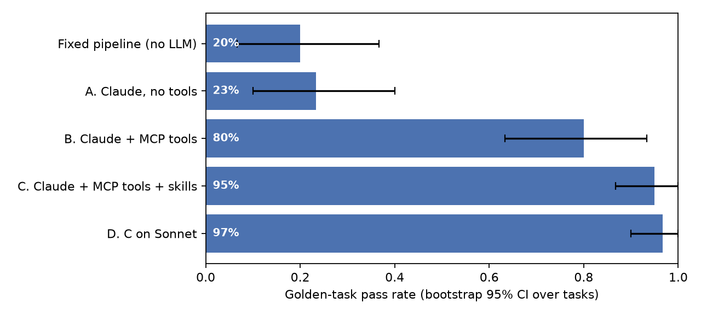
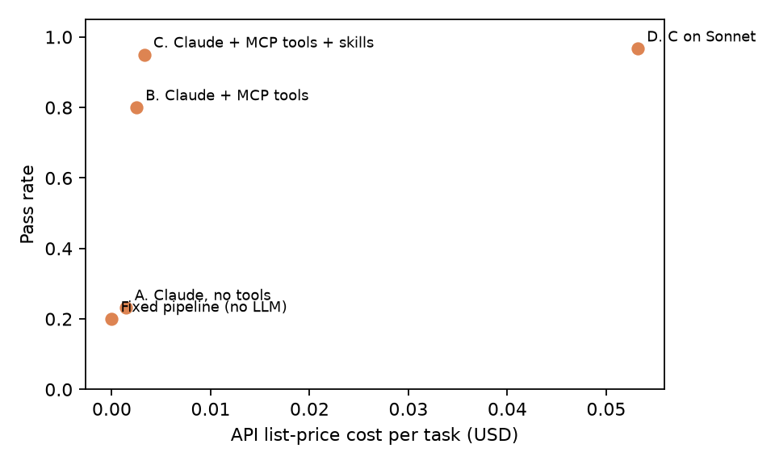

# Agent Config Bench

Controlled experiments on what makes a **tool-using agent** reliable: **tool access, reusable skills, and model choice** — with paired bootstrap confidence intervals.

The agent under test for the primary study is [healthcare-evidence-agent](https://github.com/Akhilesh-Vangala/healthcare-evidence-agent) (Claude + MCP over openFDA, ClinicalTrials.gov, CMS). The bench itself is a reusable analyze / suite / matrix framework.

| Artifact | Path |
|---|---|
| Tech report | [`reports/TECH_REPORT.md`](reports/TECH_REPORT.md) |
| Eval card | [`EVAL_CARD.md`](EVAL_CARD.md) |
| Runbook | [`docs/RUNBOOK.md`](docs/RUNBOOK.md) |
| LinkedIn copy | [`docs/LINKEDIN_POST.md`](docs/LINKEDIN_POST.md) |
| Dev suite (30) | [`suites/healthcare_dev.json`](suites/healthcare_dev.json) |
| Held-out suite (30) | [`suites/healthcare_heldout.json`](suites/healthcare_heldout.json) |
| Robustness suite | [`suites/robustness_tool_faults.json`](suites/robustness_tool_faults.json) |

## Design (primary study)

| Config | Model | MCP tools | Agent skills | Runs |
|---|---|---|---|---|
| Baseline | none (fixed pipeline) | its own hard-coded calls | none | 30 |
| A | Claude Haiku | no | no | 60 (30 × 2) |
| B | Claude Haiku | yes | no | 60 |
| C | Claude Haiku | yes | yes | 60 |
| D | Claude Sonnet | yes | yes | 30 |

**Total: 240 runs (210 agent + 30 baseline).** A task passes only if every declared check holds: right product, required sections, status, review flag, verbatim claims from retrieved sources, no invented NCT IDs.

Statistics: pass rate per task averaged over repeats; 95% CIs by bootstrap over tasks (4,000 resamples); configuration differences are **paired by task**.

## Results (dev split)

| Config | Pass rate (95% CI) | Claims verified | Invented trial IDs | Repeat consistency | MCP calls / task | Cost / task* | Median latency |
|---|---|---|---|---|---|---|---|
| Baseline | 20% (7 to 37%) | n/a | 0 runs | n/a | n/a | $0 | 0.1 s |
| A. no tools | 23% (10 to 40%) | 0% | 4 runs | 100% | 0 | $0.0014 | 10.3 s |
| B. tools | 80% (63 to 93%) | 89% | 0 | 100% | 3.8 | $0.0025 | 11.1 s |
| **C. tools + skills** | **95% (87 to 100%)** | **94%** | **0** | **97%** | **2.6** | **$0.0033** | **14.2 s** |
| D. C on Sonnet | 97% (90 to 100%) | 94% | 0 | n/a (1 run) | 2.1 | $0.0532 | 16.2 s |

\* API list price from measured token usage (some runs used a Claude subscription through headless Claude Code).



### Paired effects (same tasks, 95% CI)

| Change | Pass-rate change | Tasks improved | Tasks regressed |
|---|---|---|---|
| Baseline to C | **+75 pts** (+60 to +90) | 23 | 0 |
| A to B (add tools) | **+57 pts** (+33 to +77) | 19 | 2 (R02, R03) |
| B to C (add skills) | **+15 pts** (+2 to +30) | 5 | 1 (L11) |
| C to D (Haiku to Sonnet) | +2 pts (0 to +5) | 1 | 0 |

## Findings

1. **Tools are what make the agent grounded.** Without tools, Claude produced 210 claims and none could be traced to a retrieved source; 4 runs named NCT IDs that do not exist. With MCP tools, no configuration invented a trial ID.
2. **Tools alone make the agent less careful.** Going from A to B, refusal and off-label handling *dropped*: once the model has data, it tries to answer requests it should decline.
3. **Skills restore judgment and sharpen tool use.** Escalation / lookup skills fixed refusals and product collisions; claim verification 89%→94%; MCP calls 3.8→2.6.
4. **A bigger model is not the lever here.** Sonnet added 2 points at ~16× cost per task.
5. **What is left is over-escalation, the safe failure.** In C, remaining failures were human-review flags raised when not required — not unverifiable claims.



## v0.2 framework

```bash
pip install -e ".[dev]"

# re-analyze primary study
agent-config-bench analyze results/raw/eval-*.json

# validate suites
agent-config-bench validate-suite suites/healthcare_heldout.json --split heldout
agent-config-bench validate-suite suites/healthcare_dev.json --split dev

# CI smoke (no API keys)
agent-config-bench stub-run suites/healthcare_heldout.json
pytest -q
```

Config matrices: `configs/default.yaml`, `configs/open_weight.yaml`.  
Bring-your-own-agent contract: `src/agent_config_bench/runners/base.py`.

## Reproduce live agent runs

Runs are produced by the agent repo; this repo analyzes them. See [`docs/RUNBOOK.md`](docs/RUNBOOK.md).

```bash
# in evidence-mcp-agent
cmg-eval-agent --configs BASELINE --workers 6
cmg-eval-agent --configs A_closed_book B_tools_only C_tools_skills --repeats 2 --workers 6
cmg-eval-agent --configs D_tools_skills_sonnet --workers 5

# held-out (after freezing configs — do not tune on these failures)
cmg-eval-agent --tasks evals/golden/agent_tasks_heldout.json \
  --configs A_closed_book B_tools_only C_tools_skills --repeats 3
```

Exact primary outputs are in [`results/raw/`](results/raw/); metrics in [`results/summary.json`](results/summary.json) and [`results/paired.json`](results/paired.json).

## Held-out & robustness status

| Suite | Status |
|---|---|
| Dev (30) | **Complete** — 240-run primary study |
| Held-out (30) | **Authored + validated** — live Claude runs pending (needs API / Claude Code; see runbook) |
| Robustness (12) | **Authored** — needs upstream `inject_tool_fault` hooks |
| Open-weight E | Runner exists in agent repo — scaled eval pending |
| Routed F | Spec in `configs/open_weight.yaml` — implementation pending |

## Limitations

- 30 author-written dev tasks and 2 repeats; CIs are wide; C vs D is not significant.
- Skills were iterated with visibility into the **dev** set; use **held-out** for generalization claims.
- One tool change (paging long label sections) was made after a first C run (90% → 95%).
- Open-weight and held-out live numbers are not in `results/` until you run the runbook steps.

## License

MIT
